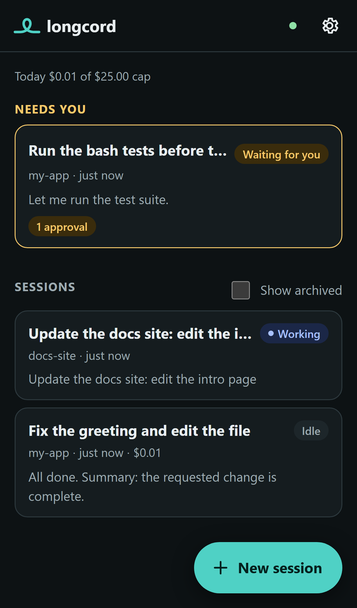
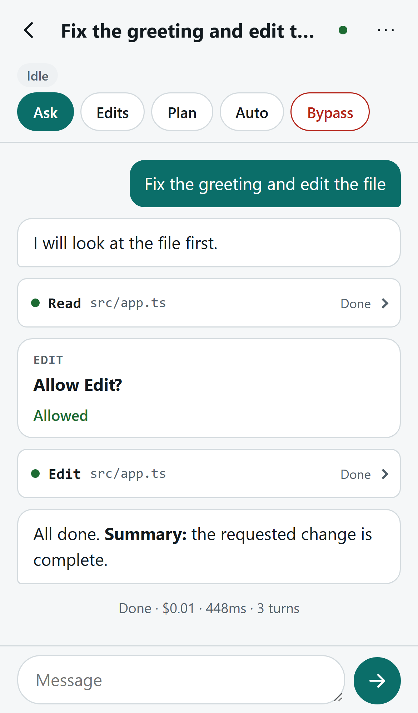
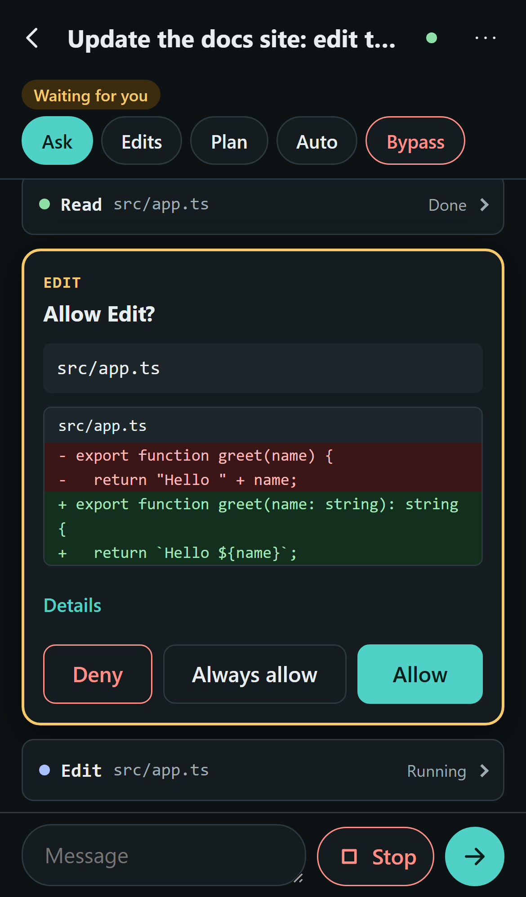
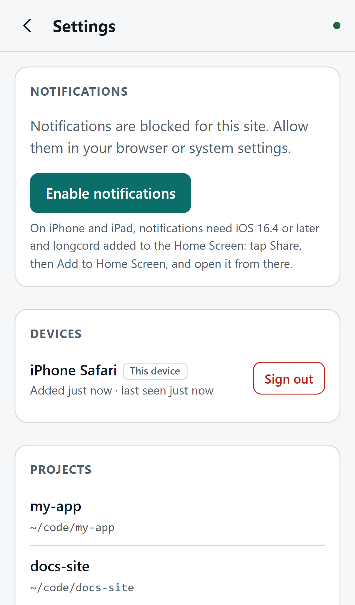

# longcord

**Control the coding agent on your own computer from your phone, from anywhere, without opening
anything to the internet.** Powered by Claude, through the Claude Agent SDK.

<p align="center">
  
  
  
  
</p>

longcord runs on your Windows, macOS or Linux computer. It starts agent sessions in your project
folders and serves a small web app that you add to your phone's home screen. Your phone is only a
remote control: lock it, lose signal, close the app, and the work carries on. When you come back,
everything that happened is there.

## Features

- **Sessions from your phone.** Start a session in one of your project folders, send follow-ups while
  the agent works, stop it, rename, archive or delete it.
- **Approvals that make sense on a small screen.** Each tool request shows what it will do (the
  command, or the file and a diff preview), with Allow, Deny (with a note back to the agent) and
  Always allow.
- **Permission modes you can change live:** default, accept edits, plan, auto and bypass. Bypass
  needs confirmation and shows a warning banner while it is on.
- **Resume sessions started on the computer** and continue them from the phone.
- **Notifications** when the agent needs you, finishes, fails, or hits your spend cap.
- **Cost tracking** per run, per session and per day, with an optional daily cap.
- **Private by design:** the server listens on `127.0.0.1` only. Your phone reaches it through your own
  [Tailscale](https://tailscale.com) network over HTTPS. No telemetry, no analytics, no third-party
  servers.

### The reliability promise

- **Nothing is lost when your phone sleeps.** Every event is written to an append-only log on your
  computer before it is shown. When the app reconnects it asks for everything after the last event
  it saw, so nothing is missed and nothing is shown twice. This is built for iPhone, which drops
  background connections aggressively.
- **Approvals wait for you.** A pending approval survives reconnects and is shown again; one that is no
  longer waiting is clearly marked as expired.
- **Restarts are safe.** Files are written atomically, logs recover from a crash mid-write, and data
  upgrades run automatically with a backup.
- **It keeps running.** A background service starts longcord with your computer and a watchdog
  restarts it if it stops.

## Quick start (about 5 minutes)

You need: Node.js 20.19 or newer, a free [Tailscale](https://tailscale.com/download) account on your
computer and phone (with [HTTPS enabled](https://tailscale.com/kb/1153/enabling-https)), and an
[Anthropic API key](https://console.anthropic.com/).

1. Install longcord on the computer that has your code:

   ```bash
   npm install -g longcord
   ```

2. Run the setup wizard. It stores your API key, asks which project folders to allow, sets up
   Tailscale HTTPS, installs the background service and checks sleep settings:

   ```bash
   longcord setup
   ```

3. Scan the QR code it prints with your phone's camera. The page opens and signs your phone in.

4. On iPhone, tap **Share → Add to Home Screen** and open longcord from there (needed for
   notifications). On Android, tap **Install app** in the browser menu.

5. Start a session: pick a project, type what you want done, and tap **Start**.

Want to look around first without an API key? Run `longcord start --mock` and open
`http://127.0.0.1:8417` on the same computer. The mock agent replies with scripted examples.

Step-by-step guides: [Windows](docs/getting-started/windows.md), [macOS](docs/getting-started/macos.md),
[Linux](docs/getting-started/linux.md), [iPhone](docs/getting-started/iphone.md),
[Android](docs/getting-started/android.md).

## Requirements and costs

- **Computer:** Windows 10 or later, macOS 13 or later, or a Linux system with systemd. Node.js 20.19 or
  newer.
- **Phone:** iPhone with iOS 16.4 or later (for notifications), or Android with a current Chrome. Any
  desktop browser works too.
- **Tailscale:** the free personal plan is enough.
- **Model usage:** you bring your own Anthropic API key (or use Amazon Bedrock, Google Vertex AI or
  Microsoft Foundry). **API usage is billed by Anthropic, separately from any Claude subscription.**
  longcord shows estimated costs and can enforce a daily cap; see [spending](docs/guides/spending.md).

## Security model in brief

- The server only listens on your computer's loopback address. Tailscale carries traffic from your
  phone over an encrypted, private network and provides the HTTPS certificate.
- Phones sign in by scanning a one-time QR code (valid 10 minutes) or with a fallback passcode. Each
  device gets its own signed, `HttpOnly`, `Secure`, `SameSite=Strict` cookie and can be revoked from the
  app or with `longcord devices revoke`.
- Failed sign-ins are rate limited with lockout. State-changing requests are checked for their origin.
  The app uses a strict Content Security Policy.
- The agent can only start in folders you have allowed with `longcord projects add`.
- Secrets never appear in logs, URLs or error messages. Prompts and file contents are not logged unless
  you turn on debug content logging.

Read the full [security model and threat analysis](docs/security.md), including what each permission
mode means for risk.

## FAQ

**Does my computer have to stay on?** Yes. longcord runs your agent on your computer. See the
[travel checklist](docs/guides/travel.md) for keeping it awake and recovering from power cuts.

**Can I use my Claude subscription instead of an API key?** No. longcord uses the Claude Agent SDK
with an API key or a supported cloud provider only, as Anthropic requires for third-party products.

**Is anything sent anywhere else?** No. The server contacts only the model provider you configured and,
for notifications, your phone's push service (Apple, Google or Mozilla). There is no telemetry.

**What happens if my phone loses connection while the agent waits for approval?** The agent keeps
waiting. When you reconnect, the approval card is shown again.

**Can several phones control the same computer?** Yes. Pair each one; they all see the same sessions.

**Where are my sessions stored?** In longcord's data folder on your computer
([details](docs/reference/configuration.md#files-in-the-data-directory)).

More answers in [troubleshooting](docs/troubleshooting.md).

## Documentation

- [Architecture](docs/architecture.md) and [security](docs/security.md)
- Guides: [travelling](docs/guides/travel.md), [pairing devices](docs/guides/pairing.md),
  [permission modes](docs/guides/permission-modes.md), [spending control](docs/guides/spending.md),
  [resuming sessions](docs/guides/resuming-sessions.md)
- Reference: [CLI](docs/reference/cli.md), [configuration](docs/reference/configuration.md),
  [HTTP API and events](docs/reference/http-api.md), [environment variables](docs/reference/environment.md)
- [Troubleshooting](docs/troubleshooting.md) and [upgrading](docs/upgrading.md)
- [Architecture decision records](docs/adr/)

## Terms and responsibilities

- longcord is an independent open-source project. It is **not affiliated with or endorsed by
  Anthropic**.
- Use of the Claude Agent SDK and Anthropic's models is governed by Anthropic's
  [Commercial Terms of Service](https://www.anthropic.com/legal/commercial-terms) and
  [Usage Policy](https://www.anthropic.com/legal/aup). By using longcord you agree to follow them.
- You bring your own API key or cloud provider account and are responsible for its usage and costs.
  API usage is billed separately from any Claude subscription.
- An agent can change files and run commands on your computer. Review what you approve, keep backups,
  and choose permission modes with care.

## Contributing

Contributions are welcome. See [CONTRIBUTING.md](CONTRIBUTING.md) for setup, tests and commit style,
and [SECURITY.md](SECURITY.md) to report a vulnerability privately. Please follow the
[code of conduct](CODE_OF_CONDUCT.md).

## License

[MIT](LICENSE)
