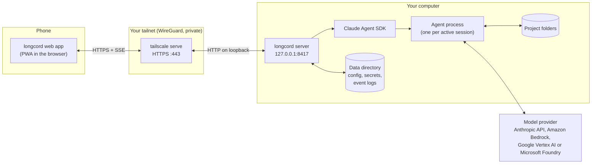
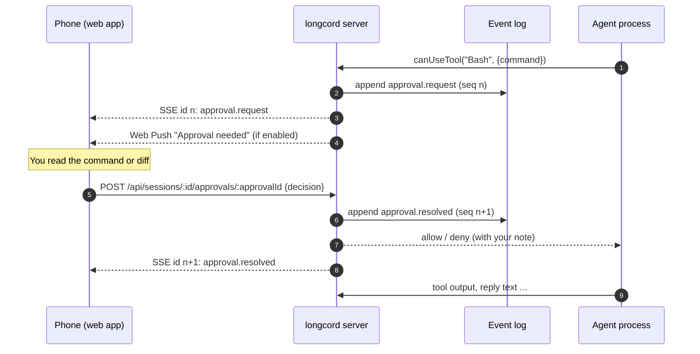

# Architecture

This page explains how the pieces of longcord fit together. You do not need it to use
longcord, but it helps when troubleshooting or contributing.

## The big picture



- **The web app** is a static Progressive Web App served by the server. It holds no data of
  its own; everything comes from the API after you sign in.
- **Tailscale** gives your phone a private, encrypted path to the computer and provides a
  real HTTPS certificate for a name like `my-pc.example-tailnet.ts.net`.
  `tailscale serve --bg --https=443 http://127.0.0.1:8417` forwards that HTTPS address to
  the server on the computer.
- **The server** (`longcord start`) is a small Node.js HTTP server built on `node:http`.
  It only listens on `127.0.0.1`, so nothing on your local network or the internet can
  reach it directly.
- **The Claude Agent SDK** starts one agent process per active session. The agent reads
  and edits files in the project folder and runs commands, asking the server for
  permission according to the session's [permission mode](guides/permission-modes.md).
- **The model provider** is whichever you configured: an Anthropic API key, or Amazon
  Bedrock, Google Vertex AI or Microsoft Foundry credentials. longcord never uses a
  claude.ai login.

## Running as a service

`longcord setup` installs a background service so the server starts with the computer and
comes back after crashes:

| OS      | Service                                                                                            |
| ------- | -------------------------------------------------------------------------------------------------- |
| Windows | Task Scheduler task `longcord`: starts at boot without sign-in when possible, otherwise at sign-in |
| macOS   | LaunchAgent `dev.longcord.agent` with `KeepAlive`                                                  |
| Linux   | systemd user unit `longcord.service` with `Restart=always`, plus `loginctl enable-linger`          |

The service runs `longcord start --service`. That is a small supervisor: it starts the
server, restarts it if it exits or stops answering `GET /healthz`, and can restart it once
a day at a fixed time (`longcord config set dailyRestart 04:00`).

## Sessions and the event log

Every session has an append-only event log on disk:

```text
<data directory>/sessions/<id>/meta.json     title, project, mode, totals
<data directory>/sessions/<id>/events.jsonl  one JSON event per line
```

Everything that happens in a session becomes an event with an increasing sequence
number (`seq`): your messages, streamed reply text, tool calls and their output, approval
requests and answers, run results, mode and state changes. The event types are defined in
`src/shared/api.ts`.

### Live updates over SSE, with replay

The web app subscribes to a session with Server-Sent Events:

```text
GET /api/sessions/<id>/events?after=<last seq the app has seen>
```

The server first replays every event after `after` from the log, then streams new events
as they are appended. Each message carries its sequence number as the SSE `id`.

This makes reconnecting simple and reliable, which matters on phones: iOS and Android
suspend background pages and drop their connections. When the app comes back to the
foreground, regains network, or is restored from the browser cache, it reconnects with the
last sequence number it saw and receives exactly what it missed. Events it already has are
ignored by sequence number, so a replay can never duplicate a message on screen. After
errors it retries with exponential backoff from 1 to 30 seconds.

A second stream, `GET /api/events`, sends small "something changed" notices (session
list, spend) so the home screen stays current. It has no replay; the app simply refetches
`GET /api/state`.

### Agent processes are released when idle

An agent process uses memory, so the server stops it after `idleTimeoutMinutes` (default 15) of inactivity, as long as no approval is waiting. The session itself is untouched. Your
next message starts a new process that continues the same conversation through the SDK's
`resume` option. This takes a few seconds.

## How an approval flows



If the agent stops waiting (you interrupted the run, the process restarted, or the request
was otherwise abandoned), the request is marked resolved as expired or cancelled. Requests
that appear in the replay but are no longer pending are shown as **Expired** in the app.

## Data directory

| OS      | Default location                                                |
| ------- | --------------------------------------------------------------- |
| Windows | `%APPDATA%\longcord`                                            |
| macOS   | `~/Library/Application Support/longcord`                        |
| Linux   | `$XDG_DATA_HOME/longcord`, by default `~/.local/share/longcord` |

Set `LONGCORD_HOME` to use another directory. Contents:

| Path                         | What it holds                                                             |
| ---------------------------- | ------------------------------------------------------------------------- |
| `config.json`                | Settings (`longcord config path` prints the location)                     |
| `secrets.json`               | API key, cookie signing secret, VAPID keys, passcode hash. File mode 600. |
| `devices.json`               | Paired devices                                                            |
| `sessions/<id>/meta.json`    | Session metadata and totals                                               |
| `sessions/<id>/events.jsonl` | The session's event log                                                   |
| `logs/longcord.log`          | Server log, rotated by size                                               |
| `backups/`                   | Copies made before data migrations (see [Upgrading](upgrading.md))        |

## Security in one paragraph

The server is reachable only over loopback, and Tailscale limits who can reach the
loopback forwarder. Every `/api` route and stream requires a signed, per-device cookie
obtained by pairing or with the passcode. State-changing requests must come from the
app's own origin, and a strict Content Security Policy blocks inline scripts. See
[Security](security.md) for the full threat model.

## Further reading

- [Architecture decision records](adr/README.md) explain why things are built this way.
- [CLI reference](reference/cli.md)
